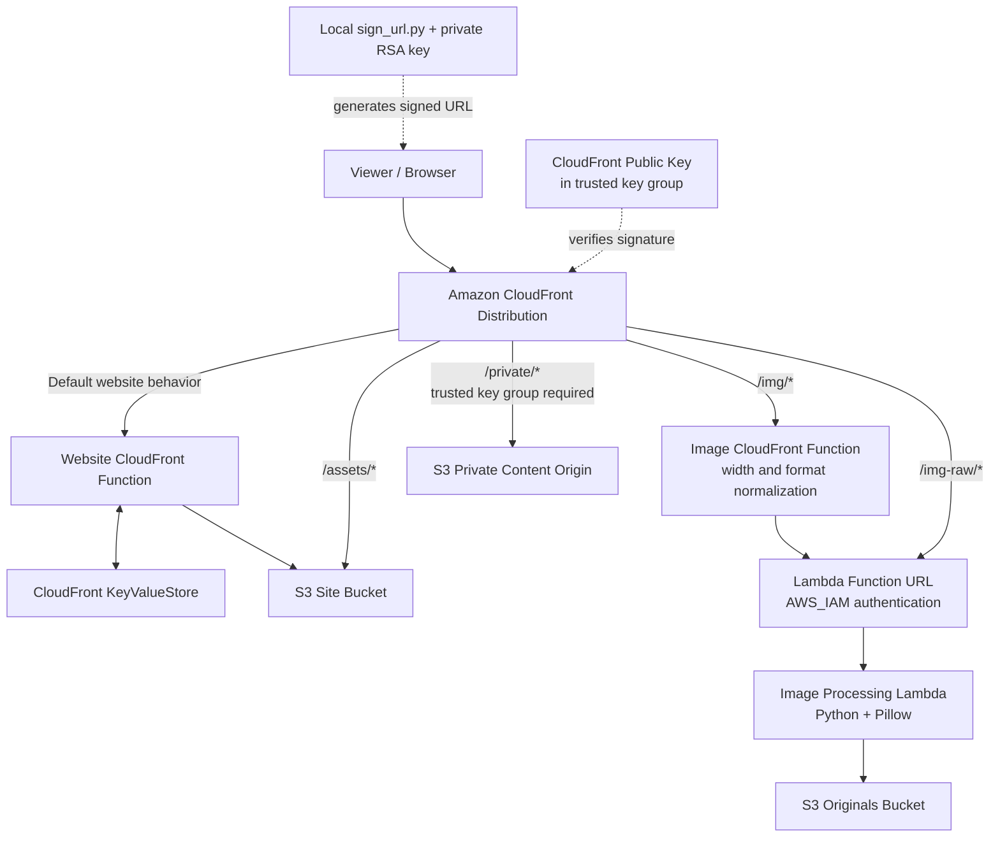

# CloudFront Edge Computing & CDN Lab

[](https://github.com/<YOUR_GITHUB_USERNAME>/<YOUR_REPOSITORY>/actions/workflows/ci.yml)

A hands-on AWS edge-computing project that combines **Amazon CloudFront, CloudFront Functions, CloudFront KeyValueStore (KVS), Amazon S3, AWS Lambda, and Terraform** to build a configurable CDN for static content, optimized images, and protected files.

The project explores how request processing at the edge and cache-key design affect content delivery, while keeping image transformation and private-content signing in dedicated components.

## Contents

- [Features](#features)
- [Architecture](#architecture)
- [Technology stack](#technology-stack)
- [Repository layout](#repository-layout)
- [How requests flow](#how-requests-flow)
- [Configuration](#configuration)
- [Local development and deployment](#local-development-and-deployment)
- [Verification and measured results](#verification-and-measured-results)
- [CI workflow](#ci-workflow)
- [Security and cost considerations](#security-and-cost-considerations)
- [Known limitations and next steps](#known-limitations-and-next-steps)

## Features

- **Global content delivery:** CloudFront distributes the static website and assets from an S3 origin.
- **Edge request handling:** CloudFront Functions handle website request logic such as clean URLs, redirects, bot filtering, geographic routing, and A/B assignment.
- **Runtime configuration:** CloudFront KeyValueStore keeps selected routing, redirect, and experiment settings outside the function code.
- **Image transformation:** A Python Lambda function uses Pillow to resize source images and encode JPEG or WebP responses.
- **Cache-key normalization:** The image edge function snaps requested widths to supported values to reduce the number of distinct cache variants.
- **Raw-versus-normalized comparison:** Separate image paths and cache policies allow cache behavior to be compared.
- **Private content delivery:** A CloudFront trusted key group and signed URLs protect the `/private/*` behavior.
- **Infrastructure as code:** Terraform provisions and connects the AWS resources.
- **Performance experiments:** A Python load-test script records HTTP status, CloudFront cache headers, latency, and summary statistics.

## Architecture

The diagram below shows the logical request paths. The website behavior, image behaviors, and private-content behavior are separate CloudFront cache behaviors. The website function is associated with the default website behavior; `/assets/*` is served directly from the site bucket; image paths invoke the image Lambda through its Function URL; and `/private/*` is protected by a trusted key group.



See [docs/ARCHITECTURE.md](docs/ARCHITECTURE.md) for component responsibilities, request sequences, trust boundaries, and design trade-offs.

## Technology stack

| Area | Technology |
|---|---|
| CDN and edge delivery | Amazon CloudFront |
| Edge request logic | CloudFront Functions (JavaScript) |
| Dynamic edge configuration | CloudFront KeyValueStore |
| Static website and source images | Amazon S3 |
| Image processing | AWS Lambda, Python 3.12, Pillow |
| Lambda invocation | Lambda Function URL with AWS IAM authentication |
| Origin authentication | CloudFront Origin Access Control (OAC) |
| Private delivery | CloudFront signed URLs and trusted key groups |
| Infrastructure | Terraform |
| Automation and tests | Python, `requests`, `python-dotenv`, pytest (where test modules are present), GitHub Actions |

## Repository layout

The main project directories are organized around infrastructure, edge logic, application code, scripts, and tests. Adjust this tree if your local filenames differ.

```text
.
├── .github/
│   └── workflows/
│       └── ci.yml
├── docs/
│   └── ARCHITECTURE.md
├── edge/                  # CloudFront Function source
├── originals/             # Original photos
├── lambda/
│   └── image/
│       └── handler.py
├── scripts/
│   ├── fingerprint.py
│   └── sign_url.py
├── site/                  # Static website files and assets
├── src/ 
├── terraform/             # AWS infrastructure definitions
├── tests/
│   ├── loadtest.py
│   └── test_lambda.py
├── .env.example           # Safe configuration template (no secrets)
├── .gitignore
└── README.md
```

The Lambda deployment package may contain platform-compatible Pillow dependencies under `lambda/image/`. Do not replace Linux Lambda dependencies with Windows-installed binaries. The deployed function uses Python 3.12 on x86_64.

## How requests flow

### Website and static assets

Requests for the website enter the CloudFront distribution. The default behavior invokes the website CloudFront Function, which can consult KVS for redirect, geographic-routing, and A/B configuration before the request reaches the S3 site origin. The `/assets/*` behavior serves static assets directly from the site bucket without invoking the website function.

Fingerprinting static asset filenames makes it possible to give versioned files long cache lifetimes. When an asset changes, the page can reference a new filename rather than requiring an invalidation of the old object.

### Image transformation and cache normalization

The `/img/*` behavior invokes an image CloudFront Function. It reads the viewer's requested width and `Accept` header, maps the width to a supported size, and sets an internal format header. The request is then forwarded to a Lambda Function URL protected by AWS IAM authentication and CloudFront OAC.

The Lambda handler:

1. extracts and validates the requested image filename;
2. retrieves the original image from the originals S3 bucket;
3. resizes it with Pillow;
4. encodes the response as JPEG or WebP; and
5. returns the encoded image with a cache-control header.

The `/img-raw/*` behavior provides a comparison path that does not apply the same width normalization. Its cache policy can therefore produce more cache variants when different width query values are requested.

The current handler expects original images at the root of the originals bucket (for example, `photo1.jpg`).

### Private content

The `/private/*` behavior uses a trusted key group. A local utility, `scripts/sign_url.py`, signs a URL using the private RSA key. CloudFront validates the signature using the corresponding public key associated with the trusted key group. The private key is not uploaded to AWS and must never be committed to source control.

### CloudFront KeyValueStore

KVS stores runtime values such as:

| Key | Example value | Purpose |
|---|---|---|
| `geo:fr` | `FR,BE,CH` | Country codes used by the geographic-routing logic |
| `ab:b_percent` | `50` | Configured percentage for variant B |
| `redirect:/old` | `/` | Redirect destination for `/old` |

These are examples from the lab configuration. The exact behavior is determined by the deployed CloudFront Function source. KVS updates use an ETag; retrieve a fresh ETag before each update.

## Configuration

Create a local `.env` file in the repository root. Keep it out of version control.

```dotenv
bucket = "your bucket name here"
domain = "your domain here"
img_function_url = "url of the image function here"
kvs_arn = "the arn of the keyvalue here"
originals = "originals here"
public_key_id = "your public id key here"
CF_KEY_ID = "your public id key here"
CDN_URL = "https://url"
IMAGE_NAME = "photo1.jpg"
MAX_REQUESTS = "40"
```

- `CDN_URL` is used by `tests/loadtest.py`.
- `IMAGE_NAME` selects the image used by the image load-test modes.
- `MAX_REQUESTS` controls the number of sequential requests; the current script enforces a maximum of 500.
- `CF_KEY_ID` identifies the CloudFront public key corresponding to the local private signing key.

Never put AWS access keys, private keys, signed URLs, or other credentials in `.env.example`, documentation, screenshots, or Git history.

## Local development and deployment

### Prerequisites

- AWS account and permissions for the resources declared in Terraform
- AWS CLI authenticated to the target account
- Terraform CLI
- Python 3.12 for the Lambda runtime and compatible packaging
- Git Bash or another shell
- OpenSSL if generating a new signing key pair

### 1. Authenticate and inspect the target account

```bash
aws login --region eu-north-1
aws configure set region eu-north-1
aws sts get-caller-identity
```

Use the region configured by the Terraform provider. CloudFront is global; the project's CloudFront KeyValueStore management workflow uses `us-north-1` where required by the AWS CLI.

### 2. Prepare signing keys (only for a new key pair)

Do not generate a replacement key pair if the existing public key is already associated with the deployed trusted key group.

```bash
mkdir -p keys
openssl genrsa -out keys/private_key.pem 2048
openssl rsa -pubout -in keys/private_key.pem -out keys/public_key.pem
```

Keep `keys/private_key.pem` private and excluded by `.gitignore`. Register the matching public key in CloudFront and associate it with the trusted key group.

### 3. Initialize and validate Terraform

```bash
terraform -chdir=terraform init
terraform -chdir=terraform fmt -check
terraform -chdir=terraform validate
terraform -chdir=terraform plan
```

Review the plan before applying it. Pay particular attention to CloudFront distributions, public keys, key groups, S3 bucket policies, and Lambda permissions.

### 4. Deploy

If the repository contains the corresponding helper scripts, review them before running them. The intended project workflow is:

```bash
python scripts/fingerprint.py
terraform -chdir=terraform apply
```

Terraform deployment and AWS uploads can create billable resources. Do not run `apply` until you have reviewed the plan and understand the resources being created or replaced.

### 5. Generate a signed URL

After configuring `CF_KEY_ID` in `.env` and placing the matching private key at `keys/private_key.pem`:

```bash
python scripts/sign_url.py "https://YOUR_CLOUDFRONT_DOMAIN/private/private.txt" 300
```

The second argument is the URL lifetime in seconds. Treat the generated URL as a temporary bearer credential: anyone who has it can use it until it expires.

### 6. Run the load tests

```bash
python tests/loadtest.py normalized
python tests/loadtest.py raw
python tests/loadtest.py asset /assets/YOUR_FINGERPRINTED_ASSET.css
python tests/loadtest.py ab
```

**Windows Git Bash note:** Git Bash may rewrite a leading-slash asset argument as a Windows filesystem path. Disable argument path conversion for that invocation:

```bash
MSYS_NO_PATHCONV=1 python tests/loadtest.py asset /assets/YOUR_FINGERPRINTED_ASSET.css
```

Use a real asset filename that exists in the deployed site bucket. The script measures sequential requests from the machine running it; it is not a distributed load generator.

## Verification and measured results

The following numbers are the observed results from this project's 40-request runs. They are measurements from one test environment, not guaranteed performance figures for other regions, networks, or cache states.

### Load-test summary

| Mode | Requests | HTTP responses | Cache hits | Hit ratio | Average | p50 | p95 | HTTP 5xx |
|---|---:|---:|---:|---:|---:|---:|---:|---:|
| Normalized images | 40 | 40 | 39 | 97.5% | 85.0 ms | 32.2 ms | 70.1 ms | 0 |
| Raw images | 40 | 40 | 36 | 90.0% | 63.6 ms | 30.9 ms | 211.3 ms | 0 |
| Static asset | 40 | 40 | 39 | 97.5% | 36.7 ms | 22.0 ms | 39.5 ms | 0 |

All three completed runs had zero network failures. The static asset test used `/assets/app.528227b6.css`.

### Interpretation

- **Static asset caching:** The first request was a cache miss at 546.7 ms. The remaining 39 requests were cache hits. This produced a 97.5% hit ratio and a 36.7 ms average across all 40 requests.
- **Normalized images:** The first request was a slow miss (about 2.0 seconds), followed by 39 hits. This explains why the overall average (85.0 ms) is much higher than the p50 (32.2 ms).
- **Raw images:** The first four distinct width values missed, then repeated requests hit. The run recorded a 90.0% hit ratio. Its p95 was affected by the initial misses.
- **Do not compare average latency in isolation:** The runs had different request paths, cache policies, and initial cache states. The figures illustrate observed behavior, not a controlled benchmark proving one path is universally faster.

## CI workflow

GitHub Actions runs on pushes and pull requests. It checks Terraform formatting and configuration validity and performs Python syntax checks. If pytest test modules are present, it runs them as well.

The workflow deliberately does **not** authenticate to AWS, deploy infrastructure, upload content, or run Terraform apply. Those actions require separate credentials and explicit approval.

## Security and cost considerations

- Never commit `keys/private_key.pem`, `.env`, AWS credentials, signed URLs, Terraform state, or local `.tfvars` files.
- Keep S3 origins private and use the configured CloudFront origin access mechanisms.
- Keep the Lambda Function URL protected by AWS IAM and the CloudFront OAC configuration.
- Keep private content behind the trusted key group and verify unsigned, expired, and tampered URL behavior.
- Use a bounded request count for experiments. Even small tests can incur CloudFront, Lambda, S3, and logging charges depending on account pricing and free-tier eligibility.
- CloudFront Functions, KVS operations, Lambda invocations, S3 requests, and data transfer have distinct pricing. Do not assume the whole architecture is free.
- An explicit AWS Organizations service control policy deny cannot be overridden by adding a local IAM allow; an organization administrator must change the SCP if an operation is blocked by it.

## Known limitations and next steps

- Verify geographic routing from known country contexts rather than inferring the viewer country from the machine's physical location.
- Add unit tests for image filename validation and width clamping, plus tests for malformed image handling.
- Record Lambda invocation counts and CloudFront edge POP identifiers alongside latency if those metrics are available.
- Repeat cache experiments after controlled invalidations or with documented cold-cache conditions for more comparable measurements.
- Consider AWS WAF rate-based rules for production rate limiting, CloudFront real-time logs for analytics, and Origin Shield where justified by traffic patterns.

## Teardown

When the lab is no longer needed, inspect the resources and destroy only the resources belonging to this project:

```bash
terraform -chdir=terraform plan -destroy
terraform -chdir=terraform destroy
```

CloudFront distribution disablement and deletion can take time. Afterwards, verify that no project buckets, distributions, functions, KVS stores, Lambda functions, key groups, or other billable resources remain.
