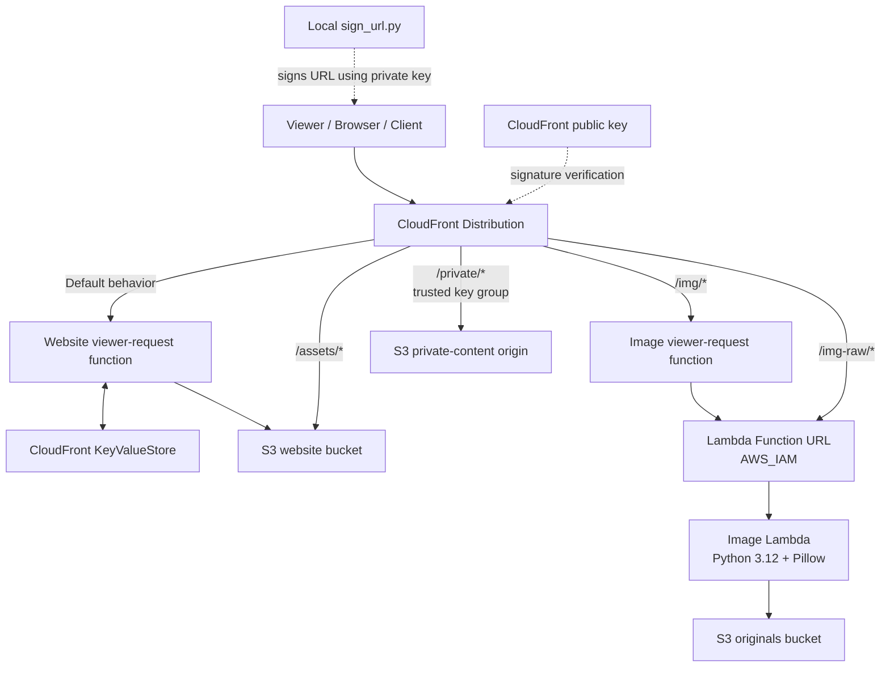

# System Architecture

This document describes the CloudFront Edge Computing & CDN lab: its AWS components, request paths, trust boundaries, and the reasons for separating edge processing from origin-side work.

## 1. System context

The system has one public entry point: an Amazon CloudFront distribution. CloudFront selects a cache behavior based on the requested path. Each behavior connects the request to the appropriate origin and, where configured, a CloudFront Function or trusted-key-group requirement.

## 2. Component responsibilities

| Component | Responsibility | Important configuration / boundary |
|---|---|---|
| CloudFront distribution | Public CDN entry point; routes requests by path behavior and caches eligible responses | Cache policies, origin configuration, behavior ordering, security settings |
| Website CloudFront Function | Applies website request logic such as redirects, bot filtering, clean URLs, geographic routing, and A/B assignment | Associated with the default website behavior; reads KVS values |
| CloudFront KeyValueStore | Stores runtime routing and experiment configuration | KVS keys are read by the website function; updates require a current ETag |
| S3 site bucket | Stores website HTML and static assets | Access should be restricted to the intended CloudFront origin access path |
| `/assets/*` behavior | Serves static assets without invoking the website request function | Fingerprinted asset names support long-lived immutable caching |
| Image CloudFront Function | Normalizes width and derives the output format from the viewer's `Accept` header | Associated with `/img/*`; reduces cache-key cardinality before origin fetch |
| `/img/*` behavior | Routes normalized image requests to the image Lambda origin | Uses the normalized image cache policy |
| `/img-raw/*` behavior | Provides a comparison route for image requests without the normalized behavior | Uses a separate raw cache policy; exact query-string treatment is defined in Terraform |
| Lambda Function URL | Provides the HTTP origin interface for image processing | AWS IAM authentication; CloudFront OAC signs origin requests |
| Image Lambda | Validates the image name, fetches the original, resizes, and encodes it | Python 3.12, Pillow, x86_64 package; reads from originals bucket |
| S3 originals bucket | Stores original images | Lambda role receives the required object-read permission |
| `/private/*` behavior | Delivers protected files | Requires a trusted key group and a valid CloudFront signed URL |
| Local signing utility | Generates time-limited CloudFront signed URLs | Uses a local private key and `CF_KEY_ID`; private key never leaves the local environment |
| Terraform | Defines AWS resources and their relationships | `terraform plan` should be reviewed before any apply or destroy |

## 3. Request flows

### 3.1 Website request

1. A viewer requests a website URL from the CloudFront domain.
2. CloudFront selects the default behavior.
3. The website viewer-request function evaluates the request. Depending on the deployed function code and KVS configuration, it may block a user agent, redirect a path, rewrite a clean URL, apply country-based routing, or assign an A/B variant.
4. The function reads relevant configuration from CloudFront KeyValueStore.
5. If no redirect or generated response is returned, CloudFront continues toward the S3 site origin and serves the object according to the behavior's cache policy.

The exact order and conditions of the edge decisions are determined by the deployed function source. The KVS example values documented in the README are configuration examples, not a guarantee that every route is active.

### 3.2 Static asset request

1. The viewer requests a fingerprinted asset, for example `/assets/app.528227b6.css`.
2. CloudFront selects the `/assets/*` behavior.
3. The request goes to the S3 site bucket without invoking the default website function.
4. If the object is cached at the selected edge location, CloudFront returns a cache hit. Otherwise, it retrieves the object from S3 and can cache it according to the cache policy and origin headers.

This path was tested with 40 sequential requests: the first response was `Miss from cloudfront`; the next 39 were `Hit from cloudfront`.

### 3.3 Normalized image request

1. The viewer requests an image under `/img/`, optionally with a width query parameter and an `Accept` header.
2. CloudFront selects the normalized image behavior and invokes the image CloudFront Function.
3. The function parses the requested width, snaps it to one of the supported widths (320, 640, or 1024), and sets an internal format header based on WebP support in `Accept`.
4. CloudFront uses the normalized request and configured cache policy to look for a cached response.
5. On a cache miss, CloudFront sends a signed origin request to the Lambda Function URL using OAC and AWS IAM authentication.
6. The Lambda handler validates the filename, retrieves the original image from S3, transforms it with Pillow, and returns the encoded image.
7. CloudFront caches the response according to the behavior's cache policy.

The Lambda handler expects the image basename at the root of the originals bucket, for example `photo1.jpg`. The current width normalization maps the test widths 321, 400, 500, and 600 to 640.

### 3.4 Raw image request

The `/img-raw/*` behavior routes image requests to the same Lambda origin but uses the raw cache policy and does not use the normalized `/img/*` behavior. When width query values are included in the cache key, different widths can create separate cache entries. This path provides a comparison against normalized requests.

The precise cache-key fields should be confirmed in the Terraform cache policy before drawing conclusions about arbitrary width values.

### 3.5 Private file request

1. A user requests a file under `/private/*` without a signature.
2. CloudFront checks the behavior's trusted key group requirement.
3. An unsigned or invalid request is rejected.
4. To grant temporary access, the project owner runs `scripts/sign_url.py` locally with the file URL and an expiry duration.
5. The utility signs the URL using the private RSA key associated with the CloudFront public key ID.
6. CloudFront verifies the signature using the public key in the trusted key group and allows the request if it is valid and unexpired.

The private key is a signing credential. It must not be stored in Git, CI artifacts, screenshots, or public documentation.

## 4. Edge configuration via KeyValueStore

The website function uses KVS to avoid hard-coding every operational value in the function source. The lab's example entries are:

| Key | Example | Meaning |
|---|---|---|
| `geo:fr` | `FR,BE,CH` | Country codes consumed by the geographic-routing logic |
| `ab:b_percent` | `50` | Percentage used by the A/B assignment logic |
| `redirect:/old` | `/` | Redirect target for `/old` |

KVS writes are conditional on an ETag. A successful update changes the ETag, so retrieve a fresh one before the next write. KVS changes can take time to propagate; measure the observed behavior rather than assuming immediate global consistency.

## 5. Cache design

| Path | Purpose | Cache design objective |
|---|---|---|
| Default website | HTML and route handling | Keep HTML freshness manageable while edge logic handles request-specific decisions |
| `/assets/*` | Fingerprinted CSS, JavaScript, and other static files | Long-lived caching for immutable, versioned filenames |
| `/img/*` | Normalized image transformation | Collapse many requested widths into a small set of cache variants |
| `/img-raw/*` | Baseline image transformation | Preserve raw cache-key behavior for comparison |
| `/private/*` | Protected content | Cache only in a way consistent with the signed-content access model and configured policy |

A cache hit ratio is meaningful only alongside the cache key, cache policy, edge location, test sequence, and cache state. Latency also depends on client network conditions, TLS reuse, edge selection, origin latency, and cold starts.

## 6. Security and trust boundaries

- **Viewer to CloudFront:** HTTPS is the public entry point. CloudFront behaviors determine which paths are public and which require signed access.
- **CloudFront to S3:** Use the configured CloudFront origin access mechanism; do not make private buckets publicly readable merely to make the CDN work.
- **CloudFront to Lambda Function URL:** The Function URL uses AWS IAM authentication, and CloudFront OAC signs origin requests. Direct unauthenticated access should be rejected.
- **Lambda to originals S3 bucket:** The Lambda execution role should have only the object-read permissions needed for the originals bucket.
- **Private content:** A trusted key group validates signatures. The private signing key remains local and is never uploaded to CloudFront.
- **Terraform state and credentials:** State files, `.tfvars`, AWS credentials, `.env`, and private keys must be excluded from version control and protected at rest.

## 7. Operational considerations

- CloudFront is a global service; regional resources such as the Lambda function and S3 buckets are deployed in the Terraform-configured region.
- CloudFront KeyValueStore management commands may require `us-east-1` in the AWS CLI workflow.
- CloudFront distribution changes and deletion can take time to propagate.
- AWS Organizations service control policies can explicitly deny operations such as CloudWatch Logs reads. A local IAM allow cannot override an organization-level explicit deny.
- CloudFront requests, Lambda invocations, S3 operations, KVS operations, logging, and data transfer can incur charges. Keep experiments bounded and inspect billing.

## 8. Design trade-offs and possible production extensions

| Design choice | Benefit | Trade-off / extension |
|---|---|---|
| CloudFront Functions for lightweight request logic | Low-latency logic close to viewers | Not suitable for heavy processing; use Lambda@Edge only when required |
| KVS for runtime settings | Change selected routing and experiment values without republishing function code | ETag management and propagation behavior must be handled |
| Lambda for image transformation | Supports image decoding, resizing, and encoding libraries | Cold starts and origin invocations on cache misses |
| Width normalization | Reduces cache fragmentation and repeated transformations | Restricts output widths to configured buckets |
| Fingerprinted static assets | Enables long-lived immutable caching | Build/deploy process must update references consistently |
| Signed URLs and trusted key groups | Time-limited access to private objects | Private key protection and key rotation are operational responsibilities |

Potential production extensions include AWS WAF rate-based rules, CloudFront real-time logs with a streaming analytics pipeline, Origin Shield where traffic patterns justify it, a custom domain with an ACM certificate, and automated key rotation procedures.
